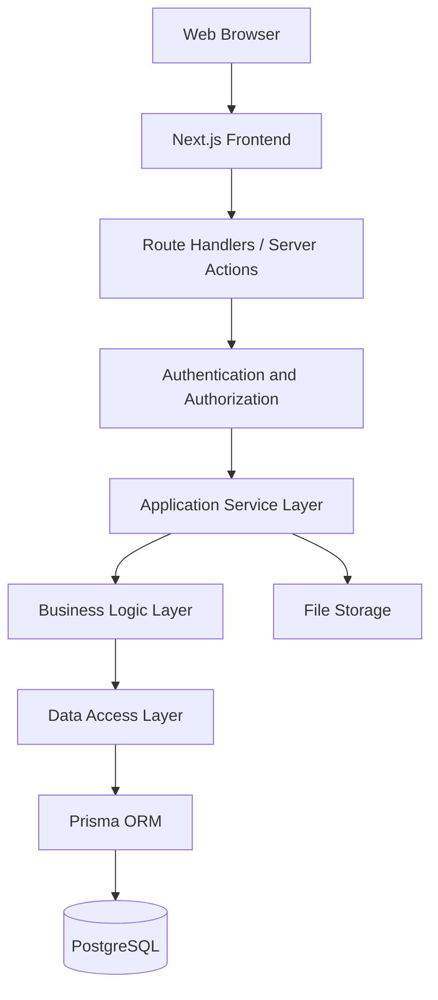
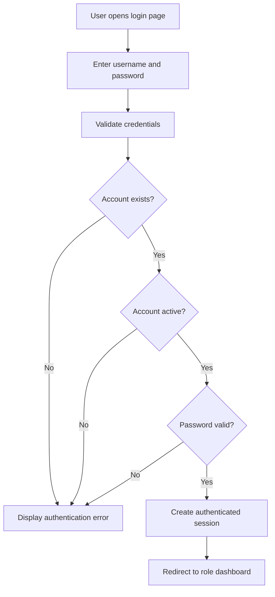
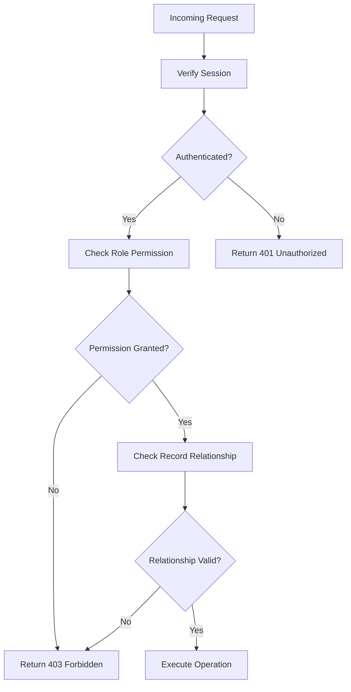
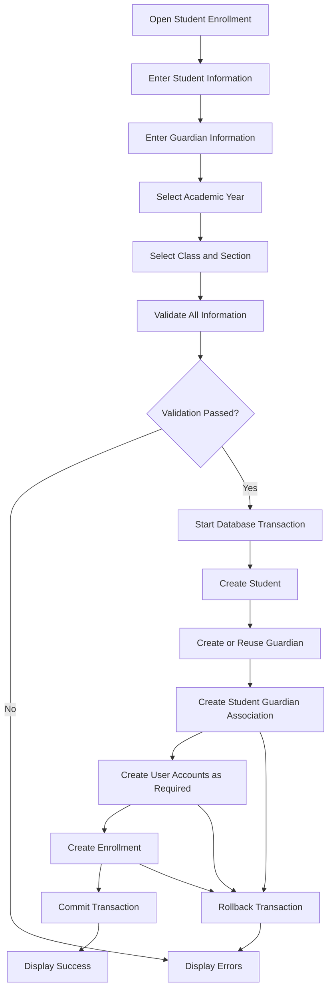
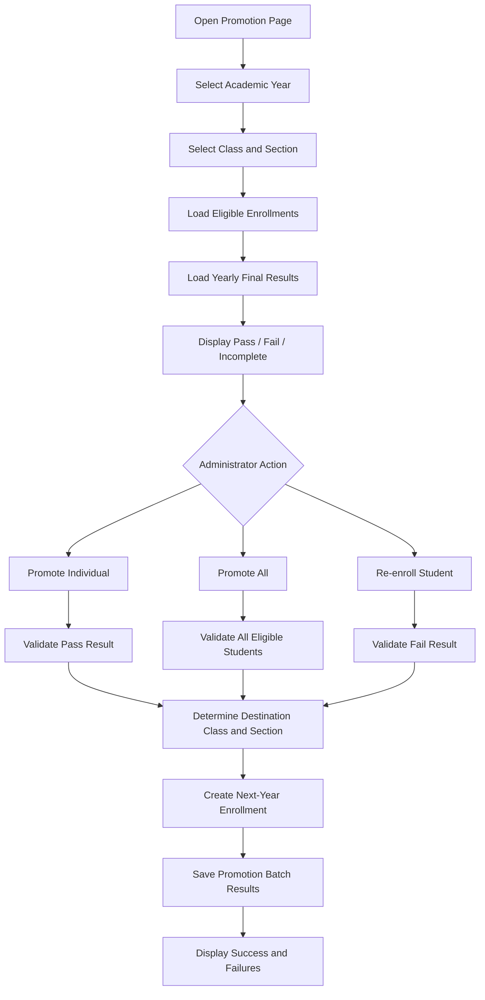
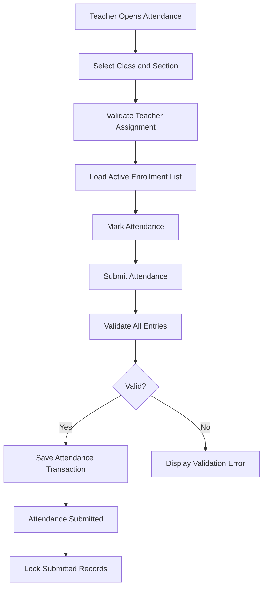
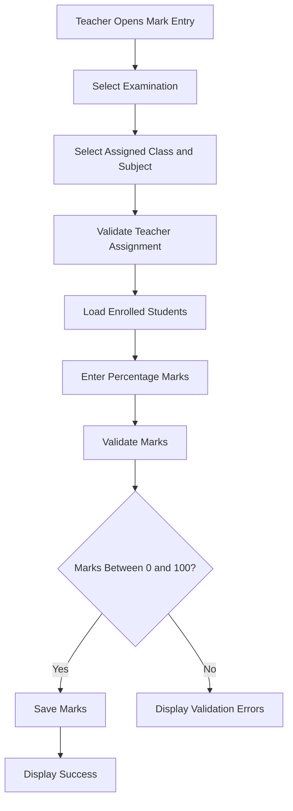
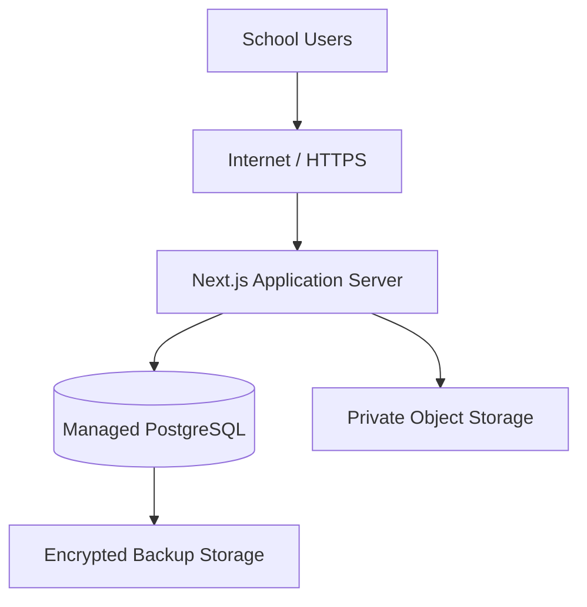

# Schoolex — Low-Level Design Document (LLD)

| Document Information | Details |
|---|---|
| Product | Schoolex |
| Document Type | Low-Level Design |
| Document Version | 1.0 |
| Source SRS | Version 0.2 |
| Source User Stories | Version 1.1 |
| Product Type | Single-school School Management System |
| Target Country | Bangladesh |
| Technology Stack | Next.js, TypeScript, Prisma, PostgreSQL |
| Interface Language | English |
| Status | Draft — For Technical Review |
| Intended Audience | Software Architects, Backend Developers, Frontend Developers, Database Designers, QA Engineers |

---

# 1. Introduction

## 1.1 Purpose

This Low-Level Design document describes the technical implementation of Schoolex.

It translates the approved business requirements and user stories into implementation-level specifications covering:

- Application architecture.
- Software modules and responsibilities.
- Database entities and relationships.
- Database constraints and indexes.
- Authentication and authorization.
- Backend service design.
- API specifications.
- Business workflows.
- Attendance management.
- Examination and result calculation.
- Student promotion and re-enrollment.
- Timetable management.
- Error handling and validation.
- File storage.
- Security.
- Testing and deployment.

This document will serve as the technical reference for implementation.

## 1.2 Design Objectives

The design shall:

1. Maintain a modular and maintainable application architecture.
2. Preserve academic history across academic years.
3. Enforce business rules at the backend and database levels.
4. Prevent unauthorized access to student and academic information.
5. Support efficient administrative operations.
6. Support bulk academic operations safely.
7. Minimize data duplication.
8. Allow future functionality without unnecessary architectural changes.

## 1.3 Scope

This design covers Version 1.0.

Included modules:

1. Authentication and User Management.
2. Student Management.
3. Guardian Management.
4. Teacher and Staff Management.
5. Academic Year Management.
6. Class and Section Management.
7. Subject Management.
8. Teacher Assignment.
9. Timetable Management.
10. Student Enrollment.
11. Student Promotion and Re-enrollment.
12. Student Attendance.
13. Examination Management.
14. Marks Management.
15. Result Calculation.
16. Dashboard and Reporting.
17. Announcements.

Excluded modules:

- Fee management.
- Payment management.
- Teacher attendance.
- Payroll.
- Library management.
- SMS and email integration.
- Mobile applications.
- Multi-school SaaS functionality.

## 1.4 Design Conventions

The following conventions will be used:

- Primary keys: UUID.
- Database naming: snake_case.
- Application variables: camelCase.
- Database tables: plural snake_case.
- API resources: plural nouns.
- Date storage: PostgreSQL date or timestamp types according to business meaning.
- Date/time display: Bangladesh Standard Time (Asia/Dhaka).
- Monetary values: Not applicable to Version 1.0.
- Percentage marks: Decimal values with a maximum of two fractional digits, subject to approval.

---

# 2. Technology Architecture

## 2.1 Technology Stack

| Layer | Technology | Responsibility |
|---|---|---|
| Frontend | Next.js | User interface |
| Programming Language | TypeScript | Application development |
| UI Styling | TBD | Interface styling |
| Backend | Next.js server-side services | Business logic |
| API | Next.js Route Handlers | HTTP endpoints |
| ORM | Prisma | Database operations |
| Database | PostgreSQL | Persistent data storage |
| Authentication | TBD | Identity and session management |
| Validation | Zod (proposed) | Input validation |
| File Storage | TBD | Student photographs and documents |
| Testing | Vitest / Playwright (proposed) | Unit and integration testing |
| Version Control | Git | Source code management |

The proposed implementation uses Next.js App Router.

The exact versions and hosting environment must be selected during technical setup.

## 2.2 High-Level Architecture

The application shall follow a layered architecture.



### Component responsibilities

**Frontend Layer**

- Render user interfaces.
- Handle user interaction.
- Perform basic client-side validation.
- Display success and error messages.
- Display role-specific navigation.
- Communicate with backend services.

**API Layer**

- Receive HTTP requests.
- Validate request structure.
- Authenticate requests.
- Enforce authorization.
- Call appropriate application services.
- Return standardized responses.

**Application Service Layer**

- Coordinate business workflows.
- Manage database transactions.
- Coordinate multiple domain operations.
- Apply business rules.

**Domain Layer**

- Maintain core business logic.
- Validate academic operations.
- Calculate results.
- Enforce promotion rules.
- Validate attendance and enrollment rules.

**Data Access Layer**

- Execute database queries through Prisma.
- Retrieve related records.
- Perform create, update, and delete operations.
- Avoid exposing database implementation details to frontend components.

**Database Layer**

- Maintain persistent application records.
- Enforce unique constraints.
- Maintain referential integrity.
- Preserve historical academic information.

## 2.3 Recommended Project Structure

```text
schoolex/
│
├── prisma/
│   ├── schema.prisma
│   ├── migrations/
│   └── seed.ts
│
├── public/
│
├── src/
│   ├── app/
│   │   ├── (auth)/
│   │   │   └── login/
│   │   │
│   │   ├── (dashboard)/
│   │   │   ├── admin/
│   │   │   ├── teacher/
│   │   │   ├── student/
│   │   │   └── guardian/
│   │   │
│   │   └── api/
│   │       └── v1/
│   │
│   ├── components/
│   │   ├── ui/
│   │   ├── forms/
│   │   ├── tables/
│   │   └── layouts/
│   │
│   ├── modules/
│   │   ├── auth/
│   │   ├── users/
│   │   ├── students/
│   │   ├── guardians/
│   │   ├── teachers/
│   │   ├── academics/
│   │   ├── enrollment/
│   │   ├── promotion/
│   │   ├── timetable/
│   │   ├── attendance/
│   │   ├── examinations/
│   │   ├── results/
│   │   ├── announcements/
│   │   ├── reports/
│   │   └── dashboard/
│   │
│   ├── lib/
│   │   ├── prisma.ts
│   │   ├── auth.ts
│   │   ├── permissions.ts
│   │   ├── validation.ts
│   │   ├── errors.ts
│   │   └── utils.ts
│   │
│   ├── types/
│   │
│   └── config/
│
├── tests/
│   ├── unit/
│   ├── integration/
│   └── e2e/
│
├── .env.example
├── package.json
└── tsconfig.json
```

### Module structure

Each business module should follow a consistent structure:

```text
students/
├── student.routes.ts
├── student.controller.ts
├── student.service.ts
├── student.repository.ts
├── student.schema.ts
├── student.types.ts
└── student.permissions.ts
```

Responsibilities:

| File | Responsibility |
|---|---|
| routes | Define HTTP endpoints |
| controller | Handle request and response |
| service | Execute business operations |
| repository | Execute database queries |
| schema | Validate input |
| types | Define TypeScript types |
| permissions | Define module-specific access rules |

For a small module, unnecessary file separation should be avoided. The architectural separation of responsibilities is more important than creating files merely to follow a template.

---

# 3. Authentication and Authorization Design

## 3.1 Supported Roles

The system shall support four roles.

```text
ADMIN
TEACHER
STUDENT
GUARDIAN
```

Staff records without a login account shall not automatically receive an application role.

## 3.2 Authentication Workflow



## 3.3 Authentication Requirements

- Passwords must be hashed using a suitable password hashing algorithm such as Argon2id.
- Plain-text passwords must never be stored.
- Session identifiers must be protected.
- Protected endpoints must validate authentication.
- Deactivated accounts must not be allowed to authenticate.
- Logout must invalidate the relevant session.
- Password reset tokens must be securely generated, time-limited, and single-use.

Authentication provider and reset delivery mechanism remain TBD.

## 3.4 Authorization Design

Authorization shall be enforced in the backend.

The system shall use two authorization dimensions:

1. Role-based permissions.
2. Record-level access restrictions.

Example:

A teacher may have permission to record attendance, but that permission does not allow the teacher to record attendance for every class.

The backend must also verify the teacher's assignment to the target class and academic context.

### Permission evaluation



### Record-level authorization examples

| Operation | Authorization condition |
|---|---|
| View student | Admin or assigned teacher or matching student account or associated guardian |
| Record attendance | Admin or authorized teacher assigned to the section |
| Enter marks | Admin or teacher assigned to the relevant subject and section |
| View results | Admin, authorized teacher, matching student, or associated guardian |
| View schedules | Admin, assigned teacher, enrolled student |
| Manage enrollment | Admin only |

A guardian's access must be validated through the student-guardian association on every protected request.

---

# 4. Database Design

## 4.1 Database Design Principles

The database shall use PostgreSQL with Prisma ORM.

The design shall follow these principles:

1. Use UUID primary keys for core entities.
2. Use foreign keys for entity relationships.
3. Enforce uniqueness at the database level.
4. Use database transactions for multi-record operations.
5. Preserve historical enrollment information.
6. Avoid deleting important academic records.
7. Store calculated result information with sufficient context to reproduce the calculation.
8. Use indexes for common search and filtering operations.
9. Use appropriate date and timestamp data types.
10. Keep user accounts separate from student, guardian, and employee profiles.

## 4.2 Entity Relationship Diagram

The following is the proposed logical ERD. It is a design baseline, not a finalized Prisma schema.

```mermaid
erDiagram
    USER ||--o| STUDENT : linked_to
    USER ||--o| GUARDIAN : linked_to
    USER ||--o| TEACHER : linked_to

    STUDENT ||--o{ STUDENT_GUARDIAN : has
    GUARDIAN ||--o{ STUDENT_GUARDIAN : associated

    STUDENT ||--o{ ENROLLMENT : has
    ACADEMIC_YEAR ||--o{ ENROLLMENT : contains
    CLASS ||--o{ ENROLLMENT : contains
    SECTION ||--o{ ENROLLMENT : contains

    LEVEL ||--o{ CLASS : contains
    CLASS ||--o{ SECTION : contains

    CLASS ||--o{ CLASS_SUBJECT : offers
    SUBJECT ||--o{ CLASS_SUBJECT : assigned

    TEACHER ||--o{ TEACHER_ASSIGNMENT : receives
    CLASS_SUBJECT ||--o{ TEACHER_ASSIGNMENT : relates
    SECTION ||--o{ TEACHER_ASSIGNMENT : assigned

    SECTION ||--o{ TIMETABLE_ENTRY : has
    TEACHER_ASSIGNMENT ||--o{ TIMETABLE_ENTRY : schedules
    PERIOD ||--o{ TIMETABLE_ENTRY : uses

    ENROLLMENT ||--o{ ATTENDANCE : has

    ACADEMIC_YEAR ||--o{ EXAMINATION : contains
    EXAMINATION ||--o{ EXAM_SUBJECT : contains
    SUBJECT ||--o{ EXAM_SUBJECT : assessed
    EXAM_SUBJECT ||--o{ STUDENT_MARK : receives
    ENROLLMENT ||--o{ STUDENT_MARK : receives

    ENROLLMENT ||--o{ RESULT_SUMMARY : has
    EXAMINATION ||--o{ RESULT_SUMMARY : calculates

    USER ||--o{ ANNOUNCEMENT : creates
    ANNOUNCEMENT ||--o{ ANNOUNCEMENT_AUDIENCE : targets
```

## 4.3 Core Database Entities

### 4.3.1 User

Purpose: Stores login and account information.

| Field | Type | Constraint |
|---|---|---|
| id | UUID | Primary key |
| username | VARCHAR | Unique, if username is adopted |
| email | VARCHAR | Nullable; uniqueness policy TBD |
| phone | VARCHAR | Nullable |
| password_hash | VARCHAR | Required |
| role_id | UUID | Foreign key |
| status | ENUM | ACTIVE, INACTIVE |
| last_login_at | TIMESTAMP | Nullable |
| created_at | TIMESTAMP | Required |
| updated_at | TIMESTAMP | Required |

### 4.3.2 Role

Purpose: Defines supported application roles.

| Field | Type | Constraint |
|---|---|---|
| id | UUID | Primary key |
| name | VARCHAR | Unique |
| description | TEXT | Nullable |

Initial role records:

- Administrator
- Teacher
- Student
- Guardian

A single primary role per user is proposed for Version 1.0. Multiple roles per account require a separate decision.

### 4.3.3 Student

| Field | Type | Constraint |
|---|---|---|
| id | UUID | Primary key |
| user_id | UUID | Nullable, unique, foreign key |
| student_code | VARCHAR | Unique |
| full_name | VARCHAR | Required |
| date_of_birth | DATE | Required status TBD |
| gender | VARCHAR | TBD |
| phone | VARCHAR | Nullable |
| email | VARCHAR | Nullable |
| present_address | TEXT | Nullable |
| permanent_address | TEXT | Nullable |
| admission_date | DATE | Required |
| blood_group | VARCHAR | Nullable |
| previous_education | JSONB | Nullable |
| photo_file_id | UUID | Nullable |
| status | ENUM | ACTIVE, INACTIVE, etc. TBD |
| created_at | TIMESTAMP | Required |
| updated_at | TIMESTAMP | Required |

The student account is optional at the database level because the student record and login account are separate concepts.

### 4.3.4 Guardian

| Field | Type | Constraint |
|---|---|---|
| id | UUID | Primary key |
| user_id | UUID | Nullable, unique |
| full_name | VARCHAR | Required |
| phone | VARCHAR | Required status TBD |
| email | VARCHAR | Nullable |
| address | TEXT | Nullable |
| occupation | VARCHAR | Nullable |
| created_at | TIMESTAMP | Required |
| updated_at | TIMESTAMP | Required |

Relationship information shall be maintained in the association table.

### 4.3.5 Student Guardian

Purpose: Implements the many-to-many relationship between students and guardians.

| Field | Type | Constraint |
|---|---|---|
| id | UUID | Primary key |
| student_id | UUID | Foreign key |
| guardian_id | UUID | Foreign key |
| relationship | VARCHAR | Required |
| is_primary | BOOLEAN | Default false |
| is_emergency_contact | BOOLEAN | Default false |
| created_at | TIMESTAMP | Required |

Unique constraint:

`UNIQUE(student_id, guardian_id)`

Additional rule: A student should have at most one primary guardian unless the school explicitly allows multiple primary guardians.

### 4.3.6 Teacher

| Field | Type | Constraint |
|---|---|---|
| id | UUID | Primary key |
| user_id | UUID | Nullable, unique |
| employee_code | VARCHAR | Unique |
| full_name | VARCHAR | Required |
| phone | VARCHAR | Required status TBD |
| email | VARCHAR | Nullable |
| employment_date | DATE | Nullable |
| employment_status | VARCHAR | Required |
| qualification | TEXT | Nullable |
| created_at | TIMESTAMP | Required |
| updated_at | TIMESTAMP | Required |

Staff members who are not teachers should have a separate Staff profile or a common Employee model. This choice should be finalized before implementing personnel management.

## 4.4 Academic Database Entities

### 4.4.1 Academic Year

| Field | Type | Constraint |
|---|---|---|
| id | UUID | Primary key |
| name | VARCHAR | Unique |
| start_date | DATE | Required |
| end_date | DATE | Required |
| is_active | BOOLEAN | Default false |
| created_at | TIMESTAMP | Required |
| updated_at | TIMESTAMP | Required |

Business constraints:

- Only one academic year can be active at a time.
- Start date must precede end date.
- Historical academic years must be retained.

A PostgreSQL partial unique index should enforce the single-active-year rule.

### 4.4.2 Level

| Field | Type | Constraint |
|---|---|---|
| id | UUID | Primary key |
| name | VARCHAR | Unique |
| sort_order | INTEGER | Required |

Initial records:

| Level | Class Range |
|---|---|
| Primary | 1–5 |
| Secondary | 6–10 |
| College | 11–12 |

### 4.4.3 Class

| Field | Type | Constraint |
|---|---|---|
| id | UUID | Primary key |
| level_id | UUID | Foreign key |
| name | VARCHAR | Required |
| sort_order | INTEGER | Required |
| is_active | BOOLEAN | Default true |

Unique constraint:

`UNIQUE(level_id, sort_order)`

Class progression should use an explicit configuration or mapping rather than relying only on arithmetic.

### 4.4.4 Section

| Field | Type | Constraint |
|---|---|---|
| id | UUID | Primary key |
| class_id | UUID | Foreign key |
| name | VARCHAR | Required |
| is_active | BOOLEAN | Default true |

Unique constraint:

`UNIQUE(class_id, name)`

### 4.4.5 Subject

| Field | Type | Constraint |
|---|---|---|
| id | UUID | Primary key |
| code | VARCHAR | Unique, if adopted |
| name | VARCHAR | Required |
| description | TEXT | Nullable |
| is_active | BOOLEAN | Default true |

### 4.4.6 Class Subject

Purpose: Defines which subjects are available in a class.

| Field | Type | Constraint |
|---|---|---|
| id | UUID | Primary key |
| class_id | UUID | Foreign key |
| subject_id | UUID | Foreign key |
| is_active | BOOLEAN | Default true |

Unique constraint:

`UNIQUE(class_id, subject_id)`

### 4.4.7 Student Enrollment

| Field | Type | Constraint |
|---|---|---|
| id | UUID | Primary key |
| student_id | UUID | Foreign key |
| academic_year_id | UUID | Foreign key |
| class_id | UUID | Foreign key |
| section_id | UUID | Foreign key |
| enrollment_status | ENUM | ACTIVE, WITHDRAWN, COMPLETED |
| enrollment_date | DATE | Required |
| created_at | TIMESTAMP | Required |
| updated_at | TIMESTAMP | Required |

Unique constraint:

`UNIQUE(student_id, academic_year_id)`

The class and section relationship must be validated to ensure the selected section belongs to the selected class.

The enrollment record must never be overwritten when a student moves to another academic year.

### 4.4.8 Teacher Assignment

Purpose: Defines a teacher's authorized teaching allocation.

| Field | Type | Constraint |
|---|---|---|
| id | UUID | Primary key |
| academic_year_id | UUID | Foreign key |
| teacher_id | UUID | Foreign key |
| class_id | UUID | Foreign key |
| section_id | UUID | Foreign key |
| subject_id | UUID | Foreign key |
| is_active | BOOLEAN | Default true |
| created_at | TIMESTAMP | Required |

The assignment must be validated against the class, section, subject, and academic year.

Multiple assignments for different sections and subjects are supported.

The timetable allocation is maintained separately.

## 4.5 Timetable Database Entities

### 4.5.1 Period

| Field | Type | Constraint |
|---|---|---|
| id | UUID | Primary key |
| period_number | INTEGER | Unique |
| name | VARCHAR | Required |
| start_time | TIME | Required |
| end_time | TIME | Required |
| is_break | BOOLEAN | Default false |
| is_active | BOOLEAN | Default true |

Initial timetable configuration:

| Period | Time |
|---|---|
| 1st Period | 08:00–09:00 |
| 2nd Period | 09:00–10:00 |
| 3rd Period | 10:00–11:00 |
| 4th Period | 11:00–12:00 |
| 5th Period | 12:00–13:00 |
| Break | 13:00–13:30 |
| 6th Period | 13:30–14:30 |
| 7th Period | 14:30–15:30 |
| 8th Period | 15:30–16:30 |

The break should be represented as a non-teaching period or schedule interval, not as a subject assignment.

### 4.5.2 Timetable Entry

| Field | Type | Constraint |
|---|---|---|
| id | UUID | Primary key |
| academic_year_id | UUID | Foreign key |
| section_id | UUID | Foreign key |
| teacher_assignment_id | UUID | Foreign key, nullable |
| day_of_week | INTEGER | Required |
| period_id | UUID | Foreign key |
| created_at | TIMESTAMP | Required |
| updated_at | TIMESTAMP | Required |

Unique constraint:

`UNIQUE(academic_year_id, section_id, day_of_week, period_id)`

A timetable slot may remain empty.

When assigned, the linked teacher assignment determines the subject and teacher.

Additional conflict validation must prevent a teacher from being assigned to two sections at the same time.

The weekday list is pending confirmation.

## 4.6 Attendance Database Entities

### Attendance

| Field | Type | Constraint |
|---|---|---|
| id | UUID | Primary key |
| enrollment_id | UUID | Foreign key |
| student_id | UUID | Foreign key |
| attendance_date | DATE | Required |
| status | ENUM | PRESENT, ABSENT, LATE, EXCUSED |
| submitted_by | UUID | User foreign key |
| submitted_at | TIMESTAMP | Required |
| created_at | TIMESTAMP | Required |

Unique constraint:

`UNIQUE(student_id, attendance_date)`

The system shall validate that the enrollment belongs to the student and that the enrollment is applicable on the attendance date.

The database should enforce immutability through restricted update permissions or an application-controlled correction mechanism. A normal teacher update operation must not be provided after submission.

## 4.7 Examination Database Entities

### Examination

| Field | Type | Constraint |
|---|---|---|
| id | UUID | Primary key |
| academic_year_id | UUID | Foreign key |
| name | VARCHAR | Required |
| examination_type | VARCHAR | TBD |
| start_date | DATE | Nullable |
| end_date | DATE | Nullable |
| status | ENUM | DRAFT, ACTIVE, COMPLETED |
| created_at | TIMESTAMP | Required |
| updated_at | TIMESTAMP | Required |

### Examination Class

Purpose: Associates an examination with relevant classes.

| Field | Type | Constraint |
|---|---|---|
| id | UUID | Primary key |
| examination_id | UUID | Foreign key |
| class_id | UUID | Foreign key |

Unique constraint:

`UNIQUE(examination_id, class_id)`

### Examination Subject

Purpose: Defines the subjects assessed in an examination for a class.

| Field | Type | Constraint |
|---|---|---|
| id | UUID | Primary key |
| examination_class_id | UUID | Foreign key |
| subject_id | UUID | Foreign key |
| full_marks | DECIMAL | Required |
| is_optional | BOOLEAN | Default false |

Unique constraint:

`UNIQUE(examination_class_id, subject_id)`

The full-marks field and percentage conversion approach require stakeholder confirmation. The current SRS defines percentage marks out of 100.

### Student Marks

| Field | Type | Constraint |
|---|---|---|
| id | UUID | Primary key |
| enrollment_id | UUID | Foreign key |
| exam_subject_id | UUID | Foreign key |
| percentage | DECIMAL(5,2) | Required |
| entered_by | UUID | User foreign key |
| created_at | TIMESTAMP | Required |
| updated_at | TIMESTAMP | Required |

Unique constraint:

`UNIQUE(enrollment_id, exam_subject_id)`

Check constraint:

`percentage >= 0 AND percentage <= 100`

The system shall verify that the enrollment's academic year and class match the examination subject's academic context.

## 4.8 Result Database Entities

### Result Summary

| Field | Type | Constraint |
|---|---|---|
| id | UUID | Primary key |
| enrollment_id | UUID | Foreign key |
| examination_id | UUID | Foreign key |
| total_marks | DECIMAL | Nullable |
| average_percentage | DECIMAL(5,2) | Nullable |
| final_status | ENUM | PASS, FAIL, INCOMPLETE |
| calculation_version | VARCHAR | Required |
| calculated_at | TIMESTAMP | Nullable |

Unique constraint:

`UNIQUE(enrollment_id, examination_id)`

A yearly final result may require aggregation across multiple examinations.

Therefore, the data model must distinguish examination-level results from yearly final results. The final implementation should not treat every examination result as the yearly promotion result.

The calculation service shall be independent of the user interface.

## 4.9 Communication Database Entities

### Announcement

| Field | Type | Constraint |
|---|---|---|
| id | UUID | Primary key |
| title | VARCHAR | Required |
| content | TEXT | Required |
| created_by | UUID | User foreign key |
| published_at | TIMESTAMP | Nullable |
| status | ENUM | DRAFT, PUBLISHED, ARCHIVED |
| created_at | TIMESTAMP | Required |
| updated_at | TIMESTAMP | Required |

### Announcement Audience

| Field | Type | Constraint |
|---|---|---|
| id | UUID | Primary key |
| announcement_id | UUID | Foreign key |
| role_id | UUID | Nullable |
| class_id | UUID | Nullable |

This supports role-specific and class-specific announcements.

The audience evaluation must use a clearly defined combination rule, especially when both role and class restrictions exist.

## 4.10 Supporting Entities

Additional entities recommended for a complete implementation:

| Entity | Purpose |
|---|---|
| File | File metadata and storage reference |
| Audit Log | Records important administrative actions |
| Password Reset Token | Secure password reset |
| Session | Authenticated user sessions, depending on provider |
| Promotion Batch | Tracks bulk promotion operations |
| Promotion Item | Tracks individual student outcomes in a batch |
| Result Calculation Run | Tracks calculation inputs, version, and outcomes |
| School Settings | Stores school-level configuration |

These supporting entities are important for operational integrity and should be finalized during detailed schema implementation.

### 4.11 Prisma Schema

generator client {
    provider = "prisma-client"
    output   = "../generated/prisma"
}

datasource db {
    provider = "postgresql"
}

// -----------------------------------------------------
// ENUMS
// -----------------------------------------------------

enum UserRole {
    ADMIN
    TEACHER
    STUDENT
    GUARDIAN
}

enum Gender {
    MALE
    FEMALE
    OTHER
}

enum AttendanceStatus {
    PRESENT
    ABSENT
    LATE
    EXCUSED
}

enum ResultStatus {
    PASS
    FAIL
    PENDING
}

enum PromotionItemStatus {
    PROMOTED
    RE_ENROLLED
    FAILED
    SKIPPED
}

enum Weekday {
    SUNDAY
    MONDAY
    TUESDAY
    WEDNESDAY
    THURSDAY
    FRIDAY
    SATURDAY
}

// -----------------------------------------------------
// AUTHENTICATION AND USER PROFILES
// -----------------------------------------------------

model User {
    id           String    @id @default(uuid()) @db.Uuid
    username     String    @unique @db.VarChar(50)
    email        String?   @unique @db.VarChar(255)
    passwordHash String    @db.VarChar(255)
    role         UserRole
    isActive     Boolean   @default(true)
    lastLoginAt  DateTime?
    createdAt    DateTime  @default(now())
    updatedAt    DateTime  @updatedAt

    student  Student?
    guardian Guardian?
    teacher  Teacher?

    createdAnnouncements Announcement[] @relation("AnnouncementCreator")

    @@index([role])
    @@index([isActive])
}

model Student {
    id            String    @id @default(uuid()) @db.Uuid
    userId        String?   @unique @db.Uuid
    admissionNo   String    @unique @db.VarChar(50)
    firstName     String    @db.VarChar(100)
    lastName      String?   @db.VarChar(100)
    dateOfBirth   DateTime? @db.Date
    gender        Gender?
    phone         String?   @db.VarChar(20)
    address       String?
    admissionDate DateTime? @db.Date
    createdAt     DateTime  @default(now())
    updatedAt     DateTime  @updatedAt

    user        User?             @relation(fields: [userId], references: [id], onDelete: SetNull)
    guardians   StudentGuardian[]
    enrollments Enrollment[]

    @@index([firstName, lastName])
}

model Guardian {
    id         String   @id @default(uuid()) @db.Uuid
    userId     String?  @unique @db.Uuid
    firstName  String   @db.VarChar(100)
    lastName   String?  @db.VarChar(100)
    phone      String   @db.VarChar(20)
    email      String?  @db.VarChar(255)
    address    String?
    occupation String?  @db.VarChar(100)
    createdAt  DateTime @default(now())
    updatedAt  DateTime @updatedAt

    user     User?             @relation(fields: [userId], references: [id], onDelete: SetNull)
    students StudentGuardian[]
}

model StudentGuardian {
    studentId          String  @db.Uuid
    guardianId         String  @db.Uuid
    relationship       String? @db.VarChar(50)
    isPrimary          Boolean @default(false)
    isEmergencyContact Boolean @default(false)

    student  Student  @relation(fields: [studentId], references: [id], onDelete: Cascade)
    guardian Guardian @relation(fields: [guardianId], references: [id], onDelete: Cascade)

    @@id([studentId, guardianId])
    @@index([guardianId])
}

model Teacher {
    id          String    @id @default(uuid()) @db.Uuid
    userId      String?   @unique @db.Uuid
    employeeNo  String    @unique @db.VarChar(50)
    firstName   String    @db.VarChar(100)
    lastName    String?   @db.VarChar(100)
    phone       String?   @db.VarChar(20)
    email       String?   @db.VarChar(255)
    address     String?
    joiningDate DateTime? @db.Date
    isActive    Boolean   @default(true)
    createdAt   DateTime  @default(now())
    updatedAt   DateTime  @updatedAt

    user        User?               @relation(fields: [userId], references: [id], onDelete: SetNull)
    assignments TeacherAssignment[]

    @@index([isActive])
}

// -----------------------------------------------------
// ACADEMIC STRUCTURE
// -----------------------------------------------------

model AcademicYear {
    id        String   @id @default(uuid()) @db.Uuid
    name      String   @unique @db.VarChar(50)
    startDate DateTime @db.Date
    endDate   DateTime @db.Date
    isActive  Boolean  @default(false)
    createdAt DateTime @default(now())
    updatedAt DateTime @updatedAt

    enrollments      Enrollment[]
    classSubjects    ClassSubject[]
    examinations     Examination[]
    promotionBatches PromotionBatch[]

    @@index([isActive])
}

model Class {
    id        String   @id @default(uuid()) @db.Uuid
    name      String   @unique @db.VarChar(50)
    sortOrder Int
    createdAt DateTime @default(now())
    updatedAt DateTime @updatedAt

    sections           Section[]
    classSubjects      ClassSubject[]
    examinationClasses ExaminationClass[]

    @@index([sortOrder])
}

model Section {
    id        String   @id @default(uuid()) @db.Uuid
    name      String   @db.VarChar(50)
    classId   String   @db.Uuid
    capacity  Int?
    createdAt DateTime @default(now())
    updatedAt DateTime @updatedAt

    class                 Class                       @relation(fields: [classId], references: [id], onDelete: Restrict)
    enrollments           Enrollment[]
    assignments           TeacherAssignment[]
    timetable             TimetableEntry[]
    announcementAudiences AnnouncementClassAudience[]

    @@unique([classId, name])
    @@index([classId])
}

model Subject {
    id        String   @id @default(uuid()) @db.Uuid
    name      String   @unique @db.VarChar(100)
    code      String   @unique @db.VarChar(30)
    createdAt DateTime @default(now())
    updatedAt DateTime @updatedAt

    classSubjects       ClassSubject[]
    examinationSubjects ExaminationSubject[]
}

// Defines which subjects are offered to a class in an academic year.
model ClassSubject {
    id             String   @id @default(uuid()) @db.Uuid
    academicYearId String   @db.Uuid
    classId        String   @db.Uuid
    subjectId      String   @db.Uuid
    createdAt      DateTime @default(now())

    academicYear AcademicYear @relation(fields: [academicYearId], references: [id], onDelete: Restrict)
    class        Class        @relation(fields: [classId], references: [id], onDelete: Restrict)
    subject      Subject      @relation(fields: [subjectId], references: [id], onDelete: Restrict)

    assignments TeacherAssignment[]

    @@unique([academicYearId, classId, subjectId])
    @@index([classId, academicYearId])
    @@index([subjectId])
}

// -----------------------------------------------------
// ENROLLMENT
// -----------------------------------------------------

model Enrollment {
    id             String   @id @default(uuid()) @db.Uuid
    studentId      String   @db.Uuid
    academicYearId String   @db.Uuid
    sectionId      String   @db.Uuid
    enrolledAt     DateTime @default(now())
    createdAt      DateTime @default(now())
    updatedAt      DateTime @updatedAt

    student      Student      @relation(fields: [studentId], references: [id], onDelete: Restrict)
    academicYear AcademicYear @relation(fields: [academicYearId], references: [id], onDelete: Restrict)
    section      Section      @relation(fields: [sectionId], references: [id], onDelete: Restrict)

    attendance   Attendance[]
    marks        StudentMark[]
    annualResult AnnualResult?

    sourcePromotionItems PromotionBatchItem[] @relation("SourceEnrollment")
    targetPromotionItems PromotionBatchItem[] @relation("TargetEnrollment")

    @@unique([studentId, academicYearId])
    @@index([academicYearId, sectionId])
    @@index([studentId])
}

// -----------------------------------------------------
// TEACHER ASSIGNMENT AND TIMETABLE
// -----------------------------------------------------

model TeacherAssignment {
    id             String   @id @default(uuid()) @db.Uuid
    teacherId      String   @db.Uuid
    classSubjectId String   @db.Uuid
    sectionId      String   @db.Uuid
    createdAt      DateTime @default(now())

    teacher      Teacher      @relation(fields: [teacherId], references: [id], onDelete: Restrict)
    classSubject ClassSubject @relation(fields: [classSubjectId], references: [id], onDelete: Restrict)
    section      Section      @relation(fields: [sectionId], references: [id], onDelete: Restrict)

    timetableEntries TimetableEntry[]

    @@unique([sectionId, classSubjectId])
    @@index([teacherId])
    @@index([sectionId])
}

model Period {
    id        String   @id @default(uuid()) @db.Uuid
    name      String   @unique @db.VarChar(30)
    startTime DateTime @db.Time
    endTime   DateTime @db.Time
    sortOrder Int
    isBreak   Boolean  @default(false)

    timetableEntries TimetableEntry[]

    @@index([sortOrder])
}

model TimetableEntry {
    id           String   @id @default(uuid()) @db.Uuid
    sectionId    String   @db.Uuid
    assignmentId String   @db.Uuid
    periodId     String   @db.Uuid
    weekday      Weekday
    createdAt    DateTime @default(now())
    updatedAt    DateTime @updatedAt

    section    Section           @relation(fields: [sectionId], references: [id], onDelete: Cascade)
    assignment TeacherAssignment @relation(fields: [assignmentId], references: [id], onDelete: Restrict)
    period     Period            @relation(fields: [periodId], references: [id], onDelete: Restrict)

    @@unique([sectionId, weekday, periodId])
    @@index([assignmentId])
    @@index([weekday, periodId])
}

// -----------------------------------------------------
// STUDENT ATTENDANCE
// -----------------------------------------------------

model Attendance {
    id             String           @id @default(uuid()) @db.Uuid
    enrollmentId   String           @db.Uuid
    attendanceDate DateTime         @db.Date
    status         AttendanceStatus
    remarks        String?
    submittedAt    DateTime         @default(now())
    createdAt      DateTime         @default(now())

    enrollment Enrollment @relation(fields: [enrollmentId], references: [id], onDelete: Restrict)

    @@unique([enrollmentId, attendanceDate])
    @@index([attendanceDate, status])
}

// -----------------------------------------------------
// EXAMINATIONS AND MARKS
// -----------------------------------------------------

model Examination {
    id             String    @id @default(uuid()) @db.Uuid
    academicYearId String    @db.Uuid
    name           String    @db.VarChar(100)
    startDate      DateTime? @db.Date
    endDate        DateTime? @db.Date
    createdAt      DateTime  @default(now())
    updatedAt      DateTime  @updatedAt

    academicYear AcademicYear       @relation(fields: [academicYearId], references: [id], onDelete: Restrict)
    classes      ExaminationClass[]

    @@unique([academicYearId, name])
    @@index([academicYearId])
}

// Connects an examination to the classes participating in it.
model ExaminationClass {
    id            String @id @default(uuid()) @db.Uuid
    examinationId String @db.Uuid
    classId       String @db.Uuid

    examination Examination          @relation(fields: [examinationId], references: [id], onDelete: Cascade)
    class       Class                @relation(fields: [classId], references: [id], onDelete: Restrict)
    subjects    ExaminationSubject[]

    @@unique([examinationId, classId])
    @@index([classId])
}

// Defines the subjects and marks structure for a class in an examination.
model ExaminationSubject {
    id                 String   @id @default(uuid()) @db.Uuid
    examinationClassId String   @db.Uuid
    subjectId          String   @db.Uuid
    maxMarks           Decimal  @db.Decimal(7, 2)
    passMarks          Decimal? @db.Decimal(7, 2)
    isOptional         Boolean  @default(false)

    examinationClass ExaminationClass @relation(fields: [examinationClassId], references: [id], onDelete: Cascade)
    subject          Subject          @relation(fields: [subjectId], references: [id], onDelete: Restrict)
    marks            StudentMark[]

    @@unique([examinationClassId, subjectId])
    @@index([subjectId])
}

model StudentMark {
    id                   String   @id @default(uuid()) @db.Uuid
    enrollmentId         String   @db.Uuid
    examinationSubjectId String   @db.Uuid
    obtainedMarks        Decimal  @db.Decimal(7, 2)
    remarks              String?
    enteredAt            DateTime @default(now())
    updatedAt            DateTime @updatedAt

    enrollment         Enrollment         @relation(fields: [enrollmentId], references: [id], onDelete: Restrict)
    examinationSubject ExaminationSubject @relation(fields: [examinationSubjectId], references: [id], onDelete: Restrict)

    @@unique([enrollmentId, examinationSubjectId])
    @@index([examinationSubjectId])
}

// Stores the calculated final result for a student's enrollment/year.
model AnnualResult {
    id                 String       @id @default(uuid()) @db.Uuid
    enrollmentId       String       @unique @db.Uuid
    totalMarks         Decimal?     @db.Decimal(10, 2)
    averagePercentage  Decimal?     @db.Decimal(5, 2)
    finalStatus        ResultStatus @default(PENDING)
    calculatedAt       DateTime?
    calculationVersion String?      @db.VarChar(30)
    createdAt          DateTime     @default(now())
    updatedAt          DateTime     @updatedAt

    enrollment Enrollment @relation(fields: [enrollmentId], references: [id], onDelete: Restrict)
}

// -----------------------------------------------------
// STUDENT PROMOTION AND RE-ENROLLMENT HISTORY
// -----------------------------------------------------

model PromotionBatch {
    id             String   @id @default(uuid()) @db.Uuid
    academicYearId String   @db.Uuid
    createdAt      DateTime @default(now())
    createdById    String   @db.Uuid
    notes          String?

    academicYear AcademicYear         @relation(fields: [academicYearId], references: [id], onDelete: Restrict)
    items        PromotionBatchItem[]

    @@index([academicYearId])
}

model PromotionBatchItem {
    id                 String              @id @default(uuid()) @db.Uuid
    batchId            String              @db.Uuid
    sourceEnrollmentId String              @db.Uuid
    targetEnrollmentId String?             @unique @db.Uuid
    status             PromotionItemStatus
    processedAt        DateTime?
    message            String?

    batch PromotionBatch @relation(fields: [batchId], references: [id], onDelete: Cascade)

    sourceEnrollment Enrollment @relation("SourceEnrollment", fields: [sourceEnrollmentId], references: [id], onDelete: Restrict)

    targetEnrollment Enrollment? @relation("TargetEnrollment", fields: [targetEnrollmentId], references: [id], onDelete: Restrict)

    @@unique([batchId, sourceEnrollmentId])
    @@index([status])
}

// -----------------------------------------------------
// ANNOUNCEMENTS
// -----------------------------------------------------

model Announcement {
    id          String    @id @default(uuid()) @db.Uuid
    title       String    @db.VarChar(200)
    content     String
    createdById String    @db.Uuid
    publishedAt DateTime?
    expiresAt   DateTime?
    isPublished Boolean   @default(false)
    createdAt   DateTime  @default(now())
    updatedAt   DateTime  @updatedAt

    createdBy User @relation("AnnouncementCreator", fields: [createdById], references: [id], onDelete: Restrict)

    roleAudiences  AnnouncementRoleAudience[]
    classAudiences AnnouncementClassAudience[]

    @@index([isPublished, publishedAt])
}

model AnnouncementRoleAudience {
    announcementId String   @db.Uuid
    role           UserRole

    announcement Announcement @relation(fields: [announcementId], references: [id], onDelete: Cascade)

    @@id([announcementId, role])
}

model AnnouncementClassAudience {
    announcementId String @db.Uuid
    sectionId      String @db.Uuid

    announcement Announcement @relation(fields: [announcementId], references: [id], onDelete: Cascade)
    section      Section      @relation(fields: [sectionId], references: [id], onDelete: Cascade)

    @@id([announcementId, sectionId])
}


---

# 5. Module-Level Design

## 5.1 Authentication Module

Responsibilities:

- Sign in.
- Sign out.
- Password reset.
- Session management.
- User activation/deactivation.
- Role assignment.
- Profile association.

Services:

```text
AuthService
 ├── login()
 ├── logout()
 ├── validateSession()
 ├── requestPasswordReset()
 └── resetPassword()

UserService
 ├── createUser()
 ├── updateUser()
 ├── activateUser()
 ├── deactivateUser()
 ├── assignRole()
 └── getUserProfile()
```

## 5.2 Student Enrollment Module

The student enrollment page is the primary entry point for new student admission.

It must support:

- Student information.
- Guardian information.
- Student-guardian association.
- Optional student login account.
- Guardian login account.
- Academic year.
- Class.
- Section.
- Initial enrollment.

### Enrollment workflow



### Important implementation rule

The entire enrollment operation must use one database transaction.

If any mandatory operation fails, all database changes from that enrollment request must be rolled back.

File uploads should be staged separately because external file storage cannot participate in a PostgreSQL transaction. The application must clean up orphaned uploaded files when a database operation fails.

### Service design

```text
EnrollmentService
 ├── createEnrollment()
 ├── validateEnrollment()
 ├── createStudent()
 ├── createOrReuseGuardian()
 ├── createGuardianAssociation()
 ├── createStudentAccount()
 ├── createGuardianAccount()
 ├── validateSectionClass()
 └── commitEnrollment()
```

Account creation must not create duplicate guardian accounts when a guardian is already registered and verified.

The matching strategy for existing guardians needs confirmation.

## 5.3 Student Promotion Module

This module handles:

- Promotion page.
- Student filtering.
- Final Pass/Fail display.
- Individual promotion.
- Promote All.
- Re-enrollment.

### Promotion workflow



### Promotion rules

1. Only students with a finalized Pass result can be promoted.
2. Students with Fail cannot be promoted.
3. Students with Incomplete results cannot be promoted.
4. Promotion creates a new enrollment.
5. Previous enrollment records remain unchanged.
6. Promotion must be idempotent: repeated requests must not create duplicate enrollments.
7. Bulk operations must provide individual success/failure outcomes.
8. A promotion operation must not silently skip failed students.

### Promotion service

```text
PromotionService
 ├── getPromotionStudents()
 ├── getYearlyResult()
 ├── validatePromotionEligibility()
 ├── promoteStudent()
 ├── promoteAll()
 ├── reenrollStudent()
 ├── determineNextClass()
 ├── determineDestinationSection()
 └── recordPromotionOutcome()
```

### Bulk promotion transaction strategy

A bulk promotion may contain many students.

The recommended approach is:

- Validate the complete candidate list.
- Record the requested promotion batch.
- Process each student independently within a controlled transaction.
- Store each student's success or failure.
- Return a batch summary.

This avoids losing all successful promotions because one student's record fails validation.

The system should also prevent two administrators from simultaneously processing the same student for the same academic year.

## 5.4 Attendance Module

Responsibilities:

- Load assigned classes.
- Load enrolled students.
- Record attendance.
- Submit attendance.
- Display attendance history.
- Generate attendance reports.

### Attendance workflow



### Attendance business rules

- One record per student per date.
- Supported statuses: Present, Absent, Late, Excused.
- The teacher must be authorized for the selected section.
- All relevant students must be included in a complete submission, unless an approved exception is defined.
- Submitted attendance is immutable for teachers.
- Database uniqueness constraints must prevent duplicates.

### Attendance service

```text
AttendanceService
 ├── getAssignedClasses()
 ├── getAttendanceRoster()
 ├── validateAttendanceSubmission()
 ├── submitAttendance()
 ├── getAttendanceHistory()
 ├── getAttendanceSummary()
 └── generateAttendanceReport()
```

The submission operation should use a database transaction and should be idempotent where possible.

## 5.5 Examination and Marks Module

Responsibilities:

- Create examinations.
- Assign examinations to classes.
- Configure examination subjects.
- Load students for mark entry.
- Enter marks.
- Edit marks.
- Validate marks.
- Calculate results.

### Marks entry workflow



### Marks service

```text
MarksService
 ├── getAuthorizedExaminations()
 ├── getAuthorizedSubjects()
 ├── getMarkEntryRoster()
 ├── validateMarks()
 ├── saveMarks()
 ├── updateMarks()
 └── getMarks()
```

Marks must be stored as percentages.

The system shall not convert marks into letter grades.

## 5.6 Result Calculation Module

The result calculation engine must be separated from marks entry.

This separation is important because result rules may change without requiring changes to examination and marks management.

### Proposed calculation process

1. Identify the student enrollment.
2. Identify the relevant academic year and examination context.
3. Retrieve the applicable examination subjects.
4. Retrieve marks for those subjects.
5. Validate completeness.
6. Calculate total marks.
7. Calculate average percentage.
8. Apply the approved pass/fail rules.
9. Store the calculation result and calculation version.
10. Make finalized yearly results available to the promotion module.

### Result calculation status

| Status | Meaning |
|---|---|
| INCOMPLETE | Required marks are missing or invalid for calculation |
| PASS | All approved passing conditions are satisfied |
| FAIL | One or more approved failing conditions apply |

### Important distinction

The SRS requires percentage marks, but it does not yet establish whether total marks mean:

- Sum of subject percentages.
- Sum of raw marks.
- Sum of weighted subject scores.

Similarly, the arithmetic or weighted average and pass threshold remain undecided.

The calculation engine shall therefore use a configurable, versioned calculation policy rather than hardcoding an unapproved formula.

## 5.7 Timetable Module

Responsibilities:

- Configure daily periods.
- Configure working weekdays.
- Assign subjects and teachers to timetable slots.
- Display class schedules.
- Display teacher schedules.
- Display student schedules.
- Validate timetable conflicts.

### Proposed timetable structure

Each timetable entry represents:

`Academic Year + Section + Weekday + Period + Teaching Assignment`

A section may have an empty period.

### Conflict detection

The system should check:

1. A section cannot have two subjects in the same period.
2. A teacher cannot teach two sections at the same time.
3. The teacher assignment must be active.
4. The teacher must be assigned to the subject and section.
5. The period must be valid and active.
6. The academic year must match.

### Timetable service

```text
TimetableService
 ├── getPeriods()
 ├── getSectionTimetable()
 ├── getTeacherTimetable()
 ├── assignTimetableEntry()
 ├── removeTimetableEntry()
 ├── validateSectionConflict()
 ├── validateTeacherConflict()
 └── getStudentTimetable()
```

## 5.8 Dashboard Module

Dashboards should use aggregated backend queries rather than loading complete datasets into the frontend.

| Dashboard | Required information |
|---|---|
| Administrator | Student totals, teacher/staff totals, classes, sections, daily attendance, admission statistics |
| Teacher | Assigned classes, subjects, timetable, attendance activities, mark entry |
| Student | Personal profile, attendance summary, results, timetable, announcements |
| Guardian | Associated students, attendance, results, announcements |

The dashboard must retrieve data according to the authenticated user's access scope.

## 5.9 Announcement Module

Responsibilities:

- Create announcements.
- Update announcements.
- Publish announcements.
- Archive announcements.
- Assign announcement audiences.
- Retrieve relevant announcements.

Announcement visibility shall be calculated on the backend.

The system must not rely only on frontend filtering to hide restricted announcements.

---

# 6. API Design

## 6.1 API Conventions

Proposed API prefix:

`/api/v1`

HTTP methods:

| Method | Purpose |
|---|---|
| GET | Retrieve records |
| POST | Create records or execute operations |
| PATCH | Update permitted fields |
| DELETE | Delete or archive records where permitted |

Use pagination for large data lists.

Suggested pagination parameters:

```text
?page=1&limit=20&search=...
```

## 6.2 Standard API Response

Success:

```json
{
  "success": true,
  "message": "Operation completed successfully",
  "data": {},
  "meta": null
}
```

Error:

```json
{
  "success": false,
  "message": "Validation failed",
  "errors": [
    {
      "field": "studentCode",
      "message": "Student ID already exists"
    }
  ]
}
```

## 6.3 Authentication APIs

| Method | Endpoint | Purpose |
|---|---|---|
| POST | /api/v1/auth/login | Sign in |
| POST | /api/v1/auth/logout | Sign out |
| GET | /api/v1/auth/me | Get current user |
| POST | /api/v1/auth/password-reset/request | Request reset |
| POST | /api/v1/auth/password-reset/confirm | Confirm reset |

## 6.4 User APIs

| Method | Endpoint | Purpose |
|---|---|---|
| GET | /api/v1/users | List users |
| POST | /api/v1/users | Create user |
| GET | /api/v1/users/:id | View user |
| PATCH | /api/v1/users/:id | Update user |
| PATCH | /api/v1/users/:id/status | Activate/deactivate |
| PATCH | /api/v1/users/:id/role | Assign role |

## 6.5 Student APIs

| Method | Endpoint | Purpose |
|---|---|---|
| GET | /api/v1/students | List students |
| POST | /api/v1/students | Create student |
| GET | /api/v1/students/:id | View student |
| PATCH | /api/v1/students/:id | Update student |
| GET | /api/v1/students/:id/history | Enrollment history |
| POST | /api/v1/students/:id/documents | Upload document |

## 6.6 Enrollment APIs

| Method | Endpoint | Purpose |
|---|---|---|
| POST | /api/v1/enrollments | Create enrollment |
| GET | /api/v1/enrollments | List enrollments |
| GET | /api/v1/enrollments/:id | View enrollment |
| PATCH | /api/v1/enrollments/:id | Update permitted enrollment data |

The initial student registration and enrollment workflow should preferably use one dedicated transactional endpoint:

`POST /api/v1/admissions`

This endpoint creates the student, guardian associations, required accounts, and initial enrollment in one controlled operation.

## 6.7 Academic APIs

| Method | Endpoint | Purpose |
|---|---|---|
| GET/POST | /api/v1/academic-years | List/create academic years |
| PATCH | /api/v1/academic-years/:id | Update academic year |
| GET/POST | /api/v1/classes | List/create classes |
| GET/POST | /api/v1/sections | List/create sections |
| GET/POST | /api/v1/subjects | List/create subjects |
| GET/POST | /api/v1/teacher-assignments | Manage teaching assignments |
| GET/POST | /api/v1/timetable | View/create timetable entries |

## 6.8 Attendance APIs

| Method | Endpoint | Purpose |
|---|---|---|
| GET | /api/v1/attendance/roster | Retrieve attendance roster |
| POST | /api/v1/attendance/submit | Submit attendance |
| GET | /api/v1/attendance | Retrieve attendance |
| GET | /api/v1/attendance/reports | Generate attendance report |

There should be no ordinary teacher attendance-update endpoint after submission.

## 6.9 Examination APIs

| Method | Endpoint | Purpose |
|---|---|---|
| GET/POST | /api/v1/examinations | List/create examinations |
| GET/PATCH | /api/v1/examinations/:id | View/update examination |
| GET/POST | /api/v1/examination-subjects | Manage examination subjects |
| GET | /api/v1/marks/roster | Retrieve mark-entry roster |
| POST | /api/v1/marks | Enter marks |
| PATCH | /api/v1/marks/:id | Update marks |
| GET | /api/v1/results | Retrieve results |
| POST | /api/v1/results/calculate | Calculate results |

## 6.10 Promotion APIs

| Method | Endpoint | Purpose |
|---|---|---|
| GET | /api/v1/promotions/students | Retrieve promotion candidates |
| POST | /api/v1/promotions/individual | Promote one student |
| POST | /api/v1/promotions/bulk | Promote eligible students |
| POST | /api/v1/promotions/reenroll | Re-enroll failed student |
| GET | /api/v1/promotions/batches/:id | Retrieve batch outcome |

Bulk promotion requests should use a stable operation identifier or idempotency key to prevent duplicate processing.

## 6.11 Reporting APIs

| Method | Endpoint | Purpose |
|---|---|---|
| GET | /api/v1/reports/students | Student report |
| GET | /api/v1/reports/attendance | Attendance report |
| GET | /api/v1/reports/results | Result report |
| GET | /api/v1/reports/dashboard | Dashboard summaries |

Export formats remain TBD.

---

# 7. Validation and Business Rules

## 7.1 Student Validation

- Student identifier must be unique.
- Required fields must be present.
- Date of birth must be a valid date.
- Admission date must be valid.
- Student status must belong to the approved status list.
- File uploads must comply with configured storage rules.

## 7.2 Enrollment Validation

- Student must exist.
- Academic year must exist.
- Class must exist.
- Section must belong to the selected class.
- Student must not already have an enrollment in the same academic year.
- Enrollment must not conflict with the student's academic history.

## 7.3 Guardian Validation

- Guardian records must be valid.
- Duplicate associations must be prevented.
- Existing guardian records should be reusable where verified.
- Guardian account associations must be checked before granting access.

## 7.4 Teacher Assignment Validation

- Teacher must exist and be active.
- Class must exist.
- Section must belong to the class.
- Subject must be offered in the class.
- Academic year must be valid.
- Duplicate active assignments should be prevented.

## 7.5 Attendance Validation

- Attendance date must be valid.
- Teacher must be authorized.
- Enrollment must be active and applicable.
- Status must be one of the supported values.
- Duplicate attendance must be prevented.
- Submitted records must not be modified through ordinary teacher operations.

## 7.6 Marks Validation

- Enrollment must be valid.
- Examination must belong to the relevant academic year.
- Examination subject must belong to the relevant examination class.
- Teacher must be authorized.
- Marks must be between 0 and 100.
- Duplicate marks must be prevented.

## 7.7 Promotion Validation

- Source enrollment must exist.
- Yearly result must be finalized.
- Result must be Pass for promotion.
- Result must be Fail for re-enrollment.
- Incomplete results cannot be promoted.
- Destination academic year must exist.
- Destination class and section must be valid.
- Duplicate enrollment must be prevented.
- Historical records must remain unchanged.

---

# 8. Security Design

## 8.1 Password Security

- Use Argon2id or an equivalent suitable password hashing algorithm.
- Never store passwords in plain text.
- Password reset tokens must be securely generated.
- Reset tokens must expire.
- Password reset tokens must be single-use.

## 8.2 Session Security

- Use secure, HTTP-only cookies.
- Enable Secure cookies in production.
- Configure appropriate SameSite behavior.
- Invalidate sessions on logout.
- Apply session expiration and renewal policies.
- Consider invalidating sessions after account deactivation or password reset.

## 8.3 API Security

- Validate authentication on protected routes.
- Validate authorization on every protected operation.
- Validate all input on the server.
- Apply rate limits to sensitive endpoints.
- Prevent insecure direct object references.
- Avoid returning sensitive internal database information.
- Use HTTPS in production.

## 8.4 File Security

- Validate MIME type and file extension.
- Restrict maximum upload size.
- Generate storage filenames instead of trusting uploaded filenames.
- Store file metadata in PostgreSQL.
- Keep private student documents in private storage.
- Use controlled file access or short-lived signed URLs.
- Prevent executable file uploads unless explicitly required and safely handled.

## 8.5 Audit Logging

Important administrative actions should be recorded.

Recommended audit fields:

| Field | Description |
|---|---|
| id | Unique identifier |
| user_id | User performing the action |
| action | Action name |
| entity_type | Affected entity |
| entity_id | Affected record |
| old_values | Previous values, where appropriate |
| new_values | New values, where appropriate |
| ip_address | Request origin, if collected |
| created_at | Event timestamp |

Recommended auditable actions:

- User activation/deactivation.
- Role assignment.
- Student record modification.
- Enrollment changes.
- Guardian association changes.
- Attendance correction by an authorized administrator.
- Examination mark modification.
- Result calculation.
- Student promotion and re-enrollment.
- Announcement publication.

Sensitive data and passwords must never be written into audit logs.

---

# 9. Error Handling

## 9.1 Standard Error Categories

| HTTP Status | Meaning |
|---|---|
| 400 | Invalid request |
| 401 | Authentication required |
| 403 | Permission denied |
| 404 | Record not found |
| 409 | Duplicate or conflicting operation |
| 422 | Business validation failure |
| 429 | Rate limit exceeded |
| 500 | Internal server error |

## 9.2 Business Error Examples

| Error Code | Description |
|---|---|
| STUDENT_ID_DUPLICATE | Student identifier already exists |
| ENROLLMENT_DUPLICATE | Student already enrolled in the academic year |
| GUARDIAN_NOT_ASSOCIATED | Guardian is not associated with student |
| TEACHER_ASSIGNMENT_INVALID | Teacher assignment is invalid |
| ATTENDANCE_ALREADY_SUBMITTED | Attendance already exists |
| ATTENDANCE_IMMUTABLE | Submitted attendance cannot be edited |
| MARK_OUT_OF_RANGE | Marks must be between 0 and 100 |
| MARK_ALREADY_EXISTS | Mark record already exists |
| RESULT_INCOMPLETE | Required result data is missing |
| PROMOTION_NOT_ALLOWED | Student is not eligible for promotion |
| PROMOTION_ALREADY_PROCESSED | Student already enrolled in destination year |
| TIMETABLE_CONFLICT | Teacher or section has a schedule conflict |

---

# 10. Performance and Database Optimization

## 10.1 Database Indexes

Recommended indexes:

| Table | Index |
|---|---|
| users | username |
| users | role_id, status |
| students | student_code |
| students | full_name |
| guardians | phone |
| teachers | employee_code |
| enrollments | student_id, academic_year_id |
| enrollments | academic_year_id, class_id, section_id |
| attendance | student_id, attendance_date |
| attendance | attendance_date, status |
| timetable_entries | academic_year_id, section_id, day_of_week |
| timetable_entries | teacher_assignment_id |
| examinations | academic_year_id |
| student_marks | enrollment_id, exam_subject_id |
| result_summaries | enrollment_id, examination_id |
| announcements | status, published_at |

Unique constraints should be implemented separately from ordinary indexes where applicable.

## 10.2 Query Optimization

- Use pagination for large lists.
- Retrieve only required columns.
- Avoid unnecessary nested relationship loading.
- Use indexes for search and filtering.
- Avoid N+1 query patterns.
- Aggregate dashboard information in database queries.
- Use transactions for multi-record operations.
- Review slow queries during testing.

Exact performance targets will be established after expected user volume is confirmed.

---

# 11. Transaction Management

The following operations require database transactions.

| Operation | Transaction Requirement |
|---|---|
| Student admission and initial enrollment | Required |
| Guardian association | Required |
| User account creation with profile association | Required |
| Attendance submission | Required |
| Bulk marks entry | Required |
| Individual student promotion | Required |
| Bulk student promotion | Per-student transaction plus batch tracking |
| Result calculation and persistence | Required |
| Academic year activation | Required |

A transaction must either complete all its database operations successfully or roll them back.

External storage operations must use a compensating cleanup process because they cannot be included in a PostgreSQL transaction.

---

# 12. Deployment Architecture

## 12.1 Proposed Deployment



## 12.2 Environment Separation

The application should have separate environments:

| Environment | Purpose |
|---|---|
| Development | Local developer environment |
| Testing | Automated and manual testing |
| Staging | Pre-production verification |
| Production | Actual school usage |

## 12.3 Environment Variables

Example:

```env
DATABASE_URL=
DIRECT_URL=
AUTH_SECRET=
APP_URL=
FILE_STORAGE_ENDPOINT=
FILE_STORAGE_BUCKET=
FILE_STORAGE_ACCESS_KEY=
FILE_STORAGE_SECRET_KEY=
```

Actual secrets must be stored in a secure environment configuration system, not committed to source control.

## 12.4 Database Migration

Prisma Migrate shall manage database schema changes.

Migration requirements:

- Every schema change must be version controlled.
- Migrations must be tested before production.
- Production migrations must be reviewed.
- Destructive migrations must include an explicit data migration strategy.
- Existing academic records must be preserved.

## 12.5 Backup and Recovery

The source SRS excludes backup and recovery, but this should be reconsidered before production.

Recommended production baseline:

- Automated database backups.
- Point-in-time recovery if supported by the selected database service.
- Separate backup storage.
- Periodic restoration testing.
- Documented recovery procedure.

Backup frequency, retention, RPO, and RTO must be approved.

---

# 13. Testing Strategy

## 13.1 Unit Testing

Test individual business functions.

Examples:

- Password validation.
- Student identifier validation.
- Enrollment validation.
- Guardian association validation.
- Attendance status validation.
- Marks range validation.
- Result calculation.
- Class progression.
- Promotion eligibility.

## 13.2 Integration Testing

Test interactions between modules and the database.

Examples:

- Student admission transaction.
- Guardian account association.
- Enrollment creation.
- Attendance submission.
- Marks entry.
- Result calculation.
- Individual promotion.
- Bulk promotion.
- Timetable conflict validation.

## 13.3 End-to-End Testing

Test complete workflows using the application interface.

Examples:

1. Administrator logs in.
2. Administrator registers a student and guardian.
3. Administrator creates the initial enrollment.
4. Administrator assigns teachers.
5. Teacher records attendance.
6. Teacher enters examination marks.
7. System calculates results.
8. Administrator promotes passing students.
9. Administrator re-enrolls failing students.
10. Student and guardian access their permitted academic information.

## 13.4 Authorization Testing

Each role must be tested against both permitted and prohibited operations.

Particular attention must be given to direct API access and manipulated record identifiers.

---

# 14. Implementation Phases

Recommended implementation sequence:

| Phase | Modules | Priority |
|---|---|---|
| 1 | Project setup, database, authentication, RBAC | Critical |
| 2 | User, student, guardian, teacher management | Critical |
| 3 | Academic years, classes, sections, subjects | Critical |
| 4 | Enrollment and teacher assignment | Critical |
| 5 | Timetable management | High |
| 6 | Student attendance | Critical |
| 7 | Examinations and marks | Critical |
| 8 | Result calculation | Critical |
| 9 | Promotion and re-enrollment | Critical |
| 10 | Dashboards and reporting | High |
| 11 | Announcements | Medium |
| 12 | Security review, QA, deployment | Critical |

Promotion development should begin only after the yearly result rules are finalized.

---

# 15. Traceability Matrix

| Source Requirement | LLD Section |
|---|---|
| Authentication and User Management | 3 |
| Student Management | 4.3, 5.2 |
| Guardian Management | 4.3, 5.2 |
| Teacher Management | 4.3, 5.2 |
| Academic Year Management | 4.4 |
| Classes and Sections | 4.4 |
| Subjects | 4.4 |
| Teacher Assignment | 4.4, 5.7 |
| Student Enrollment | 5.2 |
| Student Promotion | 5.3 |
| Student Attendance | 4.6, 5.4 |
| Examination Management | 4.7, 5.5 |
| Student Marks | 4.7, 5.5 |
| Result Calculation | 4.8, 5.6 |
| Dashboard | 5.8 |
| Reporting | 6.11 |
| Announcements | 4.9, 5.9 |
| RBAC | 3 |
| Security | 8 |
| Performance | 10 |
| Deployment | 12 |

---

# 16. Open Technical and Business Decisions

The following items require confirmation before the LLD can be finalized.

| ID | Topic | Current Status | Impact |
|---|---|---|---|
| LLD-01 | Authentication provider | TBD | Authentication implementation |
| LLD-02 | Login identifier: username, phone, or email | TBD | User schema and login |
| LLD-03 | Student ID generation | TBD | Student management |
| LLD-04 | Mandatory student fields | TBD | Forms and validation |
| LLD-05 | Mandatory guardian fields | TBD | Enrollment workflow |
| LLD-06 | Guardian account reuse and matching | TBD | Guardian management |
| LLD-07 | Single or multiple roles per account | Proposed single role | Authorization |
| LLD-08 | Teacher/staff common data model | TBD | Personnel schema |
| LLD-09 | Working weekdays | TBD | Timetable |
| LLD-10 | Teacher schedule conflict rules | Proposed validation | Timetable |
| LLD-11 | Student promotion class mapping | TBD | Promotion |
| LLD-12 | Destination section assignment | TBD | Promotion |
| LLD-13 | Failed student re-enrollment placement | TBD | Re-enrollment |
| LLD-14 | Examination types | TBD | Examination design |
| LLD-15 | Result calculation formula | TBD | Results |
| LLD-16 | Passing threshold | TBD | Results and promotion |
| LLD-17 | Missing and optional marks | TBD | Results |
| LLD-18 | Attendance correction mechanism | Proposed admin-controlled correction | Attendance |
| LLD-19 | File storage provider | TBD | Infrastructure |
| LLD-20 | File types and limits | TBD | File management |
| LLD-21 | Report formats | TBD | Reporting |
| LLD-22 | Teacher announcement publishing | TBD | Communication |
| LLD-23 | Backup and recovery | Excluded in SRS; production recommendation | Data safety |
| LLD-24 | Hosting provider | TBD | Deployment |
| LLD-25 | Performance targets | TBD | Infrastructure and optimization |

---

# 17. Technical Recommendations

The following recommendations are important for the long-term reliability of Schoolex.

1. Use database-level unique constraints instead of relying only on frontend validation.
2. Use transactions for student admission and promotion.
3. Keep historical enrollment records immutable wherever possible.
4. Store examination marks separately from calculated result summaries.
5. Use a versioned result calculation service.
6. Enforce teacher assignments at the backend.
7. Implement guardian access through verified student-guardian relationships.
8. Use private storage for student documents.
9. Implement audit logging for important academic and administrative changes.
10. Add production backup and recovery before launching with real school records.
11. Use explicit class progression configuration instead of hardcoding class numbers.
12. Keep timetable period configuration separate from individual timetable assignments.

---

# 18. Document Approval

| Role | Name | Approval |
|---|---|---|
| Product Owner | TBD | Pending |
| School Representative | TBD | Pending |
| Software Architect | TBD | Pending |
| Development Lead | TBD | Pending |

**Document Status:** Draft — For Technical Review

**Next Step:** Resolve the critical open decisions, finalize the database schema, and prepare the implementation-ready technical specification.

---

**End of Schoolex Low-Level Design Document — Version 1.0**